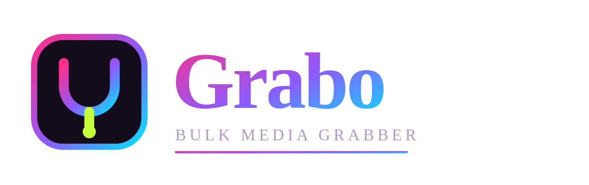
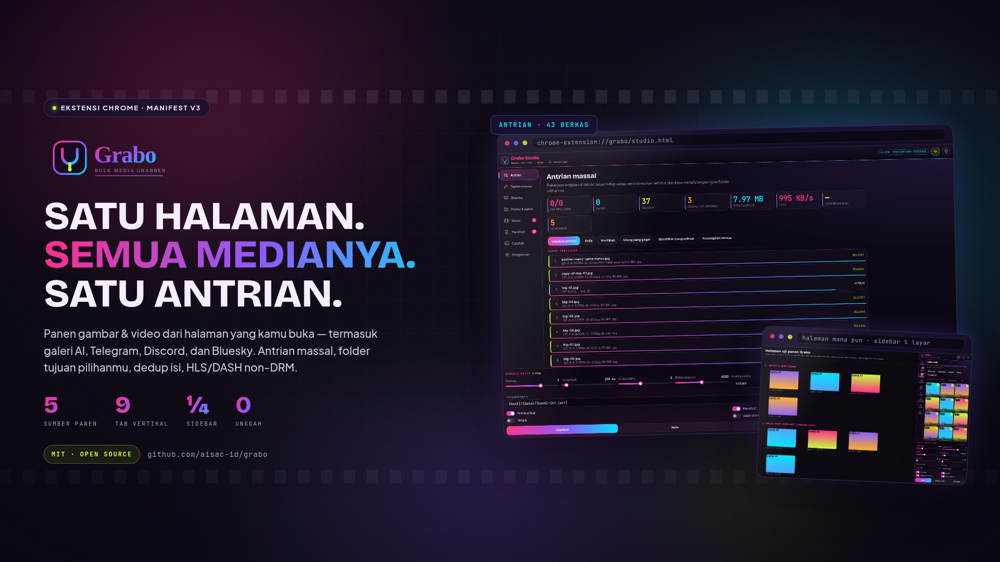
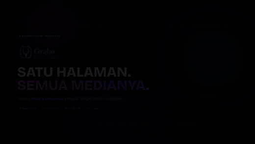

<p align="center"></p>

# Grabo — Bulk Media Grabber



Ekstensi Chrome untuk **memanen gambar & video secara massal** dari halaman yang sedang kamu buka —
dengan **antrian sungguhan**, **pilihan folder tujuan**, **dedup berbasis isi**, dan penggabungan
**HLS/DASH non-DRM**. Semua diproses di perangkatmu; tidak ada server, tidak ada telemetry.

Grabo bekerja **di dalam sesi login yang sudah ada di browsermu**. Ia tidak pernah meminta,
menyimpan, atau mengirim kata sandi, cookie, maupun token. Ia hanya membaca media yang benar-benar
dimuat oleh halaman yang kamu buka sendiri.

---

## Bentuk antarmuka

Sidebar menempel di **¼ lebar layar** (bawaan 25%, bisa digeser 18–50%), halaman ikut menyempit
sehingga tidak ada konten yang tertimpa. Tab disusun **vertikal ke bawah** pada rail kiri:

`Ringkas · Panen · Galeri · Antrian · Video · Filter · Keluaran · Sumber · Aturan`

Mesin antrian hidup di **Studio** (`studio.html`), halaman ekstensi tersendiri dengan 8 tab:
`Antrian · Tautan · Bluesky · Keluaran · Video · Manifes · Log · Aturan`.

> Kenapa Studio terpisah? Service worker MV3 tidak punya DOM dan mati saat idle. File System Access
> API, penggabungan segmen video, dan antrian yang harus tetap hidup membutuhkan halaman ekstensi
> nyata. Sidebar bertindak sebagai remote control-nya.

## Kemampuan

**Panen dari 5 sumber sekaligus**
- DOM: `img`/`srcset`/`picture`, `video`/`audio` + poster, atribut lazy (`data-src`, `data-original`, …),
  tautan unduhan, `input[type=image]`, `object`/`embed`, `svg image`
- Jaringan: URL media yang benar-benar lewat (`webRequest` observasional, buffer 1500/tab)
- Metadata: `og:image`, `og:video`, `twitter:image`, `link[rel=preload]`
- CSS: `background-image` (termasuk gambar yang tidak ada di DOM sama sekali)
- Canvas: `toDataURL()` untuk hasil yang hanya hidup di kanvas

**Gulir dalam** untuk galeri malas-muat: `IntersectionObserver`, tombol "muat lebih", dan konten yang
baru dibuat skrip saat wadahnya terlihat.

**Antrian massal**
- pekerja 1–4, jeda per-host 0–4000 ms, coba ulang 0–5 dengan backoff eksponensial
- laju (KB/s) + ETA dari jendela geser 15 detik
- jeda/lanjut/batal per pekerjaan, ulang yang gagal, antrian **persisten** (tahan reload & tidur browser)
- dedup **SHA-256 atas isi berkas**, bukan atas URL — nama berbeda dengan isi sama ditulis sekali
- normalisasi URL: `utm_*`, `fbclid`, `gclid`, `_nc_ht`, `ig_cache_key` dibuang sebelum dibandingkan

**Folder tujuan sungguhan**
`showDirectoryPicker({ mode: 'readwrite' })` → Grabo menulis ke folder mana pun yang kamu pilih,
bukan hanya ke Downloads. Template jalur: `{host}/{date}/{base}-{n}.{ext}`.
Mode cadangan `chrome.downloads` tersedia (terbatas di dalam folder Downloads, sesuai aturan Chrome).

**Video**
- HLS `.m3u8` (TS maupun fMP4) → pilih varian terbaik, gabung init + fragmen menjadi `.ts`/`.mp4`
- DASH `.mpd` non-DRM → gabung representation terbaik
- **DRM dihormati**: setiap `EXT-X-KEY`/`EXT-X-SESSION-KEY` dengan METHOD ≠ NONE, dan setiap
  `ContentProtection` pada DASH, ditandai `protected` dan **tidak diunduh**
- `blob:` dan `data:` dibaca dari konteks halaman (satu-satunya tempat URL itu sah)

**Tautan massal & Bluesky**
Tempel daftar URL (satu per baris) — Grabo membuka tiap halaman berurutan, memanen, lalu menutupnya.
Bluesky memakai AT Protocol publik (`public.api.bsky.app`) untuk profil/handle yang kamu masukkan.

**Adapter situs** — heuristik gulir & selektor khusus untuk galeri (Instagram/TikTok/X),
Telegram Web, Discord, dan galeri generator AI (Dreamina, CapCut, Leonardo, Midjourney, Ideogram,
Krea, Runway, Pika, Kling, Luma, Civitai, Tensor.Art, SeaArt). Adapter hanya menggulir dan membaca
DOM yang sudah kamu muat; tidak ada pemanggilan API privat, tidak ada self-bot.

**Filter langsung** — jenis media, lebar/tinggi/ukuran minimum, lewati yang kecil & thumbnail,
hanya yang terlihat, pola include/exclude. Setiap perubahan langsung diterapkan ke hasil panen
tanpa perlu memindai ulang.

**Manifes** — setiap pekerjaan tercatat: URL, nama, jenis, hash SHA-256, jumlah byte, jumlah segmen,
status, jalur keluaran, dan waktu. Ditulis sebagai `manifest.json` di folder tujuan dan bisa diunduh sebagai salinan JSON.

## Batasan yang disengaja

- Tidak menyimpan kredensial apa pun. Grabo menumpang sesi yang sudah login di browsermu.
- Tidak menembus DRM, paywall, atau konten yang dilindungi.
- Ada jeda per-host bawaan (400 ms) dan batas pekerja. Ini bukan alat scraping tanpa rem.
- Untuk arsip besar akun Instagram/TikTok milikmu sendiri, **ekspor data resmi** jauh lebih lengkap
  dan lebih sopan terhadap server. Grabo untuk halaman yang benar-benar kamu buka.
- Jangan memakai Grabo untuk memanen media orang lain secara massal. Hormati hak cipta dan
  ketentuan layanan tiap situs.

## Pasang (mode pengembang)

```bash
git clone https://github.com/aisac-id/grabo.git
```

1. Buka `chrome://extensions`
2. Aktifkan **Developer mode**
3. **Load unpacked** → pilih folder repositori ini
4. Pin ikon Grabo, lalu klik ikonnya atau tekan **Alt+Shift+G**

Chrome 116+ (File System Access API + MV3).

### Pintasan

| Pintasan | Aksi |
| --- | --- |
| `Alt+Shift+G` | buka / tutup sidebar |
| `Alt+Shift+P` | panen halaman aktif |
| `Alt+Shift+S` | buka Studio |
| `↑` / `↓` pada rail | pindah tab |
| klik ganda ubin galeri | pratinjau besar (`Esc` menutup) |

Klik kanan pada gambar/video juga menambahkannya langsung ke antrian.

## Alur pakai singkat

1. Buka halaman yang ingin kamu panen (dalam keadaan sudah login).
2. `Alt+Shift+G` → tab **Panen** → **Panen sekarang** (aktifkan gulir dalam untuk galeri panjang).
3. Tab **Galeri**: pilih semua / pilih sebagian, lihat pratinjau.
4. Tab **Keluaran**: **Pilih folder tujuan**.
5. **Masukkan ke antrian** → Studio terbuka → **Jalankan**.
6. Tab **Manifes** di Studio untuk catatan lengkap, atau **Log** untuk melihat keputusan mesin.

## Demo & pengujian

`demo/` adalah fixture lokal yang sengaja berisi kasus sulit: gambar malas-muat, gambar yang hanya
ada di CSS, kanvas, duplikat isi dengan URL berbeda, URL 403, URL yang gagal 2× lalu berhasil,
HLS TS, HLS fMP4, DASH, serta HLS/DASH terenkripsi.

```bash
node tools/serve-demo.js            # http://127.0.0.1:8731/index.html
node tools/test-grabo.js            # uji runtime nyata di Chrome (butuh puppeteer-core)
```

Suite menjalankan Chrome sungguhan dengan ekstensi termuat dan memeriksa dok ¼ layar, semua sumber
panen, filter langsung, antrian (konkurensi, jeda, retry, dedup), penulisan berkas + manifes,
penggabungan HLS/DASH, penandaan DRM, mode `chrome.downloads`, panen tautan massal, Bluesky langsung,
ketahanan reload, dan perilaku penuh di viewport ponsel. Laporan: `tools/test-report.json`.

## Struktur

```
manifest.json        MV3
background.js        service worker: setelan, pengamat jaringan, menu konteks, panen berantai
sidebar.html/js      remote control ¼ layar, 9 tab vertikal
studio.html/js       mesin antrian, folder tujuan, manifes, log
src/harvest.js       mesin panen 5 sumber + filter + gulir dalam
src/queue.js         antrian persisten: pekerja, pacer per-host, retry, dedup
src/writer.js        File System Access / chrome.downloads
src/hls.js           HLS (TS & fMP4) + DASH, deteksi DRM
src/adapters.js      heuristik per situs
src/bluesky.js       AT Protocol publik
src/audio.js         umpan balik suara (aktif bawaan, satu tombol bisu)
src/util.js          normalisasi URL, hash, sniff magic-byte, template jalur
demo/                fixture uji lokal
tools/               generator fixture, server demo, harness uji
brand/               logo & logomark (vektor + PNG)
promo/               kotak perangkat lunak, poster, aset sosial, video promo
```

## Kit promosi

`promo/` berisi kotak perangkat lunak 3D, poster, hero, aset sosial (OG/persegi/story),
lembar fitur, dan **satu video promo bersuara** — semuanya dirender dari HTML/CSS memakai
tangkapan layar asli hasil uji runtime, bukan mockup.

[](promo/grabo-promo.mp4)

Buka `promo/index.html` untuk galeri lengkap, atau lihat [promo/README.md](promo/README.md).
Semua materi MIT; membuatnya ulang: `node tools/build-promo.js && node tools/build-video.js`.

## Lisensi

MIT — lihat [LICENSE](LICENSE). Font berlisensi SIL OFL 1.1 ([fonts/OFL.txt](fonts/OFL.txt)),
atribusi pihak ketiga di [THIRD_PARTY_NOTICES.md](THIRD_PARTY_NOTICES.md).

Kontribusi: [CONTRIBUTING.md](CONTRIBUTING.md).